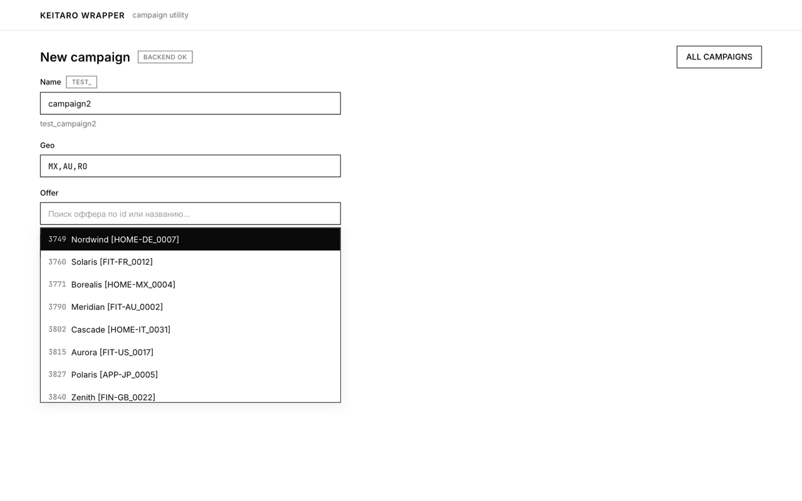
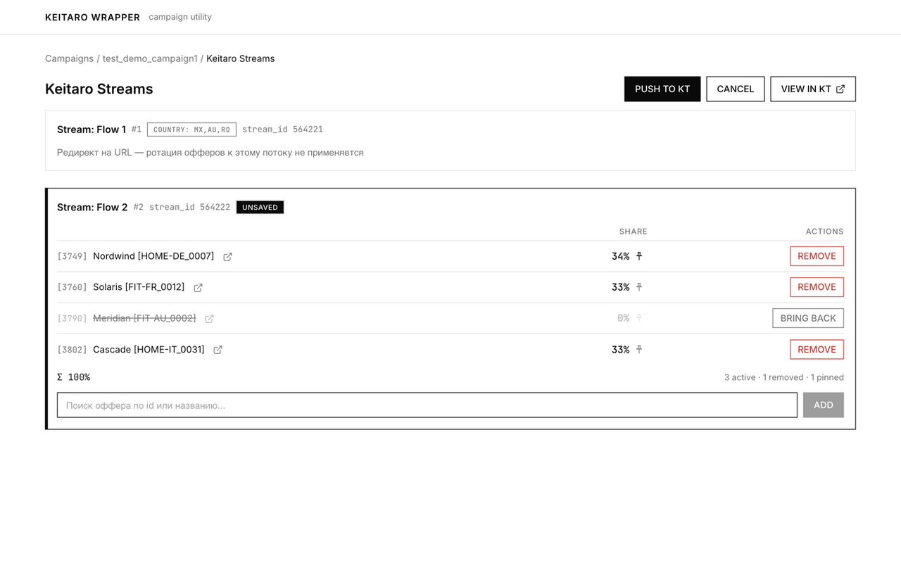
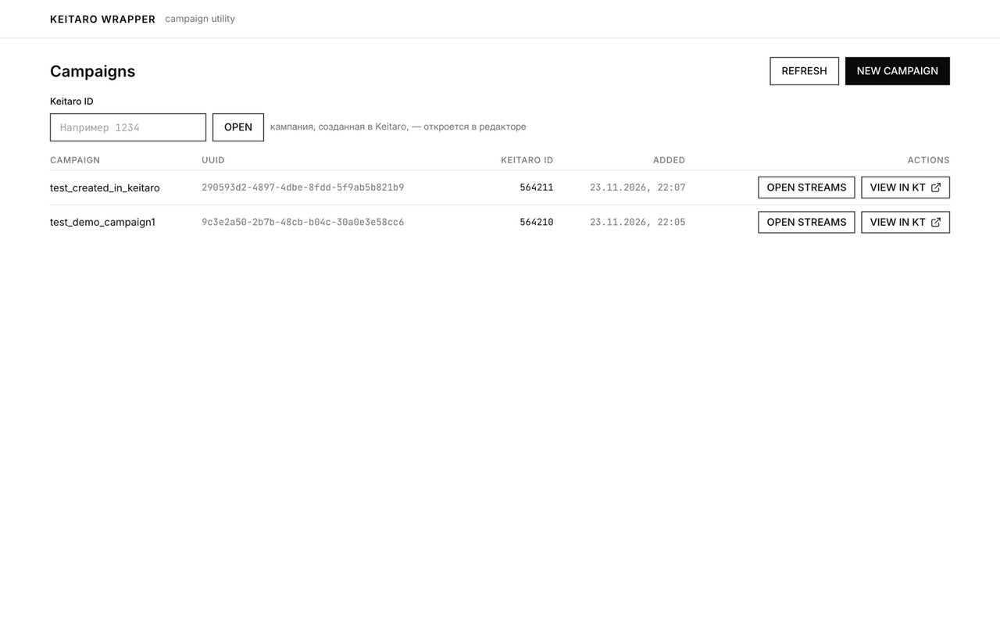

# Keitaro Wrapper

Обёртка над рекламным трекером **Keitaro** (Admin API) — веб-утилита для двух повседневных операций с кампаниями:

1. **«Создаватор» кампаний** — форма (название / гео / оффер) создаёт в Keitaro кампанию с двумя потоками: Flow 1 (редирект на Google с гео-фильтром) и Flow 2 (выбранный оффер).
2. **Редактор существующей кампании** — управление офферами в потоках кампании: добавление, удаление, возврат, пересчёт долей (сумма всегда 100%, закреплённую долю можно зафиксировать пином), отправка изменений в Keitaro и откат.

Обе части работают с одним и тем же трекером: созданную кампанию сразу можно открыть в редакторе, а кампанию, созданную прямо в Keitaro, — по её id.

## Скриншоты

**«Создаватор»:** автокомплит ищет офферы по id и названию, под полем Name виден префикс и итоговое имя кампании.



**Редактор существующей кампании:** пин закрепляет долю оффера — 34% не изменились, когда список правился; убранный оффер зачёркнут с долей 0%, остальные доли пересчитаны; несохранённые правки помечены `UNSAVED`.



**Список кампаний** (`/campaigns`) — кампании со ссылками на редактор и админку Keitaro; здесь же открывается кампания, созданная прямо в Keitaro.




## Стек

- Бэкенд: **FastAPI + SQLAlchemy + Alembic**, Python 3.12
- Фронтенд: **Vue 3 + TypeScript + Vite**; собранный SPA (`frontend/dist`) раздаёт сам бэкенд — отдельно поднимать ничего не нужно
- База: SQLite, только для маппинга кампаний (см. [Архитектура](#архитектура))

## Быстрый старт

Нужны Python 3.12+, Node.js ≥ 20 и API-ключ Keitaro с правами на кампании, потоки, офферы, группы, источники трафика и домены (админка Keitaro → Профиль → API ключи).

Все команды — из корня репозитория: файл `.env` ищется в текущем каталоге.

**Бэкенд**

```bash
python3.12 -m venv .venv && source .venv/bin/activate
pip install -r requirements.txt
cp .env.example .env      # заполнить KT_BASE_URL, KT_API_KEY, CAMPAIGN_PREFIX
alembic upgrade head      # создаст dev.db с таблицей campaigns
```

**Фронт**

```bash
cd frontend && npm i && npm run build && cd ..
```

**Запуск** (в терминале с активированным `.venv`)

```bash
uvicorn app.main:app
```

Откройте http://127.0.0.1:8000 — попадёте на «создаватор». Проверка, что всё поднялось:

```bash
curl -s http://127.0.0.1:8000/api/health   # {"status":"ok","database":"ok"}
```

Документация API: http://127.0.0.1:8000/api/docs. Настройки читаются один раз при старте — после правки `.env` перезапустите `uvicorn`.

### Что произойдёт при первом запуске

- **Создание кампании.** Имя в Keitaro получается как `CAMPAIGN_PREFIX` + введённое название. Группа `KT_GROUP_NAME` и источник трафика `KT_SOURCE_NAME` находятся в трекере по имени, а если их нет — создаются. Домен берётся из `KT_DOMAIN_ID`, иначе первый активный домен трекера.
- **Потоки новой кампании.** Flow 1 — редирект на `https://google.com/` с фильтром «принимать страны» по введённым кодам; Flow 2 — выбранный оффер со 100% доли. Ротация потоков — по позиции.
- **Редактор существующей кампании.** Список кампаний — `/campaigns`, оттуда `OPEN STREAMS`. Кампания, созданная прямо в Keitaro, открывается по её id: поле `Keitaro ID` → `OPEN`. Правки (ADD / REMOVE / BRING BACK) живут в браузере до нажатия `PUSH TO KT`; `CANCEL` отбрасывает их и перечитывает Keitaro. Состав потоков запоминается в локальной БД (таблица `stream_offer_memory`): оффер, удалённый из потока прямо в админке Keitaro, после FETCH показывается строкой «0% + BRING BACK» (state `deleted`), а `PUSH TO KT` восстанавливает его в Keitaro как disabled с долей 0. Редактируются потоки со схемой «Landings and offers» — у редиректа и действия офферы не ротируются.
- **Доли.** После каждого изменения состава потока доли активных офферов пересчитываются поровну, а лишний процент достаётся первому (3 → 34 / 33 / 33). Пин рядом с долей закрепляет её: закреплённая доля не меняется, а остаток до 100% делится между остальными (25% закреплено, офферов трое → 25 / 38 / 37). Само закрепление долей не меняет. Пин — состояние редактора, Keitaro его не хранит: закрепления живут в localStorage браузера и переживают перезагрузку страницы (в другом браузере их не будет).

## Разработка фронтенда

```bash
cd frontend
npm i
npm run dev             # http://localhost:5173, запросы /api проксируются на :8000
npm run build           # пересборка dist (в git не попадает)
```

Рядом запустите `uvicorn app.main:app` — дев-сервер ходит в API через прокси.

## UI без доступа к Keitaro

Чтобы посмотреть интерфейс без ключа и трекера, приложение можно поднять с заглушкой Keitaro: те же страницы, демонстрационные офферы и кампания с двумя потоками, всё в памяти и до остановки процесса.

```bash
.venv/bin/python scripts/dev_mock.py          # http://127.0.0.1:8000
.venv/bin/python scripts/dev_mock.py 8080     # другой порт
```

Нужен собранный фронт (`npm run build`). В трекер при этом ничего не пишется, `dev.db` не используется.

## Переменные окружения

Задаются в `.env` (образец — `.env.example`); переменные окружения имеют приоритет над файлом.

| Переменная | Назначение | По умолчанию |
|---|---|---|
| `KT_BASE_URL` | Адрес корня трекера, без `/admin` — `https://<ваш-Keitaro>` | `https://tlgk.host` |
| `KT_API_KEY` | API-ключ Keitaro. Без него запросы к трекеру отвечают ошибкой с подсказкой | пусто |
| `DATABASE_URL` | База приложения | `sqlite:///./dev.db` |
| `CAMPAIGN_PREFIX` | Префикс имён создаваемых кампаний | `test_` |
| `KT_GROUP_NAME` | Группа, в которую попадают новые кампании (создаётся, если нет) | `FORTESTS` |
| `KT_SOURCE_NAME` | Источник трафика для новых кампаний (создаётся, если нет) | `FORTESTS` |
| `KT_DOMAIN_ID` | Домен новых кампаний; пусто — первый активный домен трекера | пусто |

## Тесты

```bash
.venv/bin/pytest        # или pytest в активированном venv
```

Тесты не ходят в сеть и не зависят от `.env`: обмен с Keitaro заменён заглушкой на `httpx.MockTransport`, примеры ответов трекера лежат в `tests/fixtures/`.

## Проверка связи с трекером

Ручная проверка доступа к Keitaro перед первым запуском (нужен `.env` с ключом):

```bash
.venv/bin/python scripts/smoke_keitaro.py
```

Скрипт печатает количество офферов, доменов, групп и источников трафика и имя country-фильтра из каталога фильтров потоков.

## API

| Метод | Путь | Что делает |
|---|---|---|
| `GET` | `/api/health` | Живость приложения и связь с базой |
| `GET` | `/api/config` | Префикс имён кампаний для формы |
| `GET` | `/api/campaigns` | Кампании, известные приложению; удалённые в Keitaro помечены `deleted_in_keitaro` |
| `POST` | `/api/campaigns` | Создать кампанию в Keitaro с двумя потоками |
| `DELETE` | `/api/campaigns/{uuid}` | Убрать кампанию из локального списка (Keitaro не трогается) |
| `POST` | `/api/campaigns/link` | Связать кампанию Keitaro с приложением по её id — чтобы открыть в редакторе |
| `GET` | `/api/campaigns/{uuid}/streams` | Потоки кампании — всегда актуальные данные из Keitaro |
| `PUT` | `/api/campaigns/{uuid}/streams/{stream_id}` | Заменить офферы потока (остальные поля потока сохраняются) |
| `GET` | `/api/offers/search?q=` | Поиск офферов по id и названию для автокомплита |

Любая ошибка — JSON вида `{"detail": "<текст для человека>"}`. Сбои Keitaro превращаются в `502` (нет ответа, 4xx/5xx от трекера) или `504` (таймаут) с текстом, что проверить: адрес трекера, API-ключ, доступность. Отсутствующий `KT_API_KEY` — сразу `503` без обращения к трекеру.

## Архитектура

```
браузер — Vue 3 SPA (frontend/)
   │  /api/*
FastAPI
   ├── api/routes.py        REST: валидация запросов, решения приложения («не найдено»)
   ├── api/errors.py        любые сбои → JSON {detail} с понятным текстом
   ├── services/            бизнес-логика
   │     campaign_creator   «создаватор»: гео-коды, alias, кампания + два потока
   │     campaigns          связь кампаний Keitaro с приложением (uuid → id)
   │     streams            чтение и правка потоков
   │     offers             поиск офферов, ссылка на URL оффера
   │     shares             пересчёт долей (сумма 100)
   └── keitaro/client.py    транспорт к Admin API + свои исключения
```

**Состояние живёт в Keitaro.** Трекер — единственный источник правды о кампаниях, потоках и офферах, поэтому приложение ничего не кэширует у себя: каждая загрузка редактора читает актуальные данные из Keitaro, а отправляет только изменённое (`PUT` потока). Локальная SQLite хранит лишь маппинг «наш uuid → id кампании в Keitaro» плюс имя и дату добавления — этого достаточно для списка кампаний и ссылок на редактор.

**Клиент Keitaro — только транспорт.** `KeitaroClient` принимает и отдаёт словари «как есть», без преобразований (например, `group_id` в Keitaro — строка), а все сбои HTTP превращает в свои исключения, поэтому дальше транспортного слоя сырых ошибок httpx нет.

### Что учтено при работе с Admin API

- Фильтры потока в ответах Keitaro отдают `payload` строкой (`"MX,AU,RO"`), а при создании потока ждут массив — приложение приводит ответ к массиву кодов.
- В запросах на создание обязательны поля, которые легко упустить: `type` у группы (`campaigns`), `type` (`regular`) и `action_type` у потока.
- Тип редиректа для Flow 1 берётся из каталога `/stream_types` по точному ключу `http_redirect` — порядок ключей в каталоге не гарантирован.
- URL оффера читается из `action_payload` и попадает в ссылку «открыть» только если это абсолютный `http`/`https`-адрес.
- `PUT /streams/{id}` отправляет поток целиком с новым списком офферов. Оффер, убранный из потока, уходит в Keitaro с `state: "disabled"` и долей 0 и остаётся в потоке отключённым: он не участвует в ротации, но его можно вернуть (`BRING BACK`). Это касается и офферов, удалённых прямо в админке Keitaro: бэк помнит виденный состав потоков (таблица `stream_offer_memory` в локальной БД) и при `PUSH TO KT` восстанавливает такие записи как disabled. Так удаление работает независимо от того, заменяет ли Keitaro массив офферов целиком или объединяет с существующим. Запасной вариант — константа `REMOVED_OFFERS_STRATEGY = "omit"` в `app/services/streams.py`: удалённые просто не входят в запрос.
- Если кампания создана, а один из потоков — нет, кампания остаётся в Keitaro без записи в локальной базе: приложение сообщит об ошибке, а такую кампанию нужно удалить в админке вручную.

## Структура

```
app/
├── main.py              FastAPI: /api/* + раздача frontend/dist + SPA-fallback
├── config.py            настройки (pydantic-settings, .env)
├── db.py                SQLAlchemy: engine + сессия
├── models.py            Campaign: uuid ↔ keitaro_campaign_id
├── api/                 routes.py (REST), errors.py (ответы об ошибках)
├── services/            campaign_creator.py, campaigns.py, streams.py, offers.py, shares.py
└── keitaro/             client.py (транспорт), exceptions.py
frontend/
├── src/pages/           HomePage (создаватор), CampaignsPage (список кампаний), StreamsPage (редактор)
├── src/components/      StreamCard, CampaignForm, OfferAutocomplete, Ui* (кнопка, инпут, бейдж, тосты)
├── src/lib/             shares.ts, streams.ts — пересчёт долей и правки на странице
└── src/assets/fonts/    Inter, JetBrains Mono (self-host)
alembic/                 миграции (0001 — создание campaigns)
scripts/
├── smoke_keitaro.py     проверка доступа к трекеру
└── dev_mock.py          запуск приложения с заглушкой Keitaro
tests/                   pytest: фикстуры ответов Keitaro, заглушка Admin API, тесты клиента, сервисов и API
docs/screenshots/        скриншоты для этого README
```
